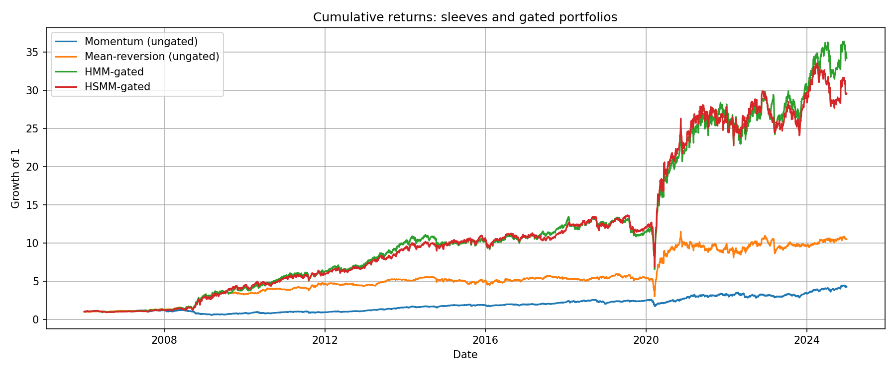

# Does regime duration matter? HMM vs HSMM for strategy allocation

Individual research paper, McGill University (FINE 547), December 2025.
**[Read the paper (PDF)](report/hmm_vs_hsmm_regime_switching.pdf)**

A standard hidden Markov model assumes regimes are memoryless: the chance of leaving
a regime is the same on day 2 as on day 200, so regime lengths are geometric. A hidden
semi-Markov model (HSMM) drops that assumption and models how long each regime lasts.
This project tests whether that extra structure improves a practical decision:
switching daily between a momentum sleeve and a mean-reversion sleeve on S&P 500 stocks.

The two models are identical in every other respect (same five SPY features, two
Gaussian states, expanding-window retraining every 21 days, and the same hard gate),
so any difference comes from the duration model alone.

**Finding:** regime gating itself helps a lot, but duration modelling barely does.
Both gated strategies lift the Sharpe ratio from 0.47–0.69 for the standalone sleeves to
about 0.9. The HSMM separates "good" and "bad" regimes more sharply and stays defensive
for longer in drawdowns. Over the full sample, though, it trades slightly lower tail risk
for slightly lower return. This agrees with Baitinger & Hoch (2024) and extends their
result from regime-conditional weights to hard switching between strategies.



## Out-of-sample results, 2006–2024

| Strategy | Ann. return | Ann. vol | Sharpe | Max drawdown | Daily CVaR 95% |
|---|---:|---:|---:|---:|---:|
| Momentum sleeve (always on) | 9.8% | 20.8% | 0.47 | −53.2% | 3.2% |
| Mean-reversion sleeve (always on) | 14.7% | 21.4% | 0.69 | −49.5% | 2.9% |
| **HMM-gated** | 21.4% | 23.4% | **0.91** | −51.3% | 3.3% |
| **HSMM-gated** | 20.5% | 23.2% | **0.89** | −49.5% | 3.2% |

Returns are gross of transaction costs, annualised arithmetically, with a risk-free rate of zero.

| Regime (SPY, by model) | Ann. return | Ann. vol | Mean / median length (days) |
|---|---:|---:|---:|
| HMM trend | 8.5% | 12.1% | 84.5 / 43 |
| HMM chop | 8.5% | 29.2% | 42.4 / 24 |
| HSMM trend | 11.0% | 12.4% | 44.5 / 13.5 |
| HSMM chop | 4.7% | 27.1% | 27.9 / 7 |

The HMM's two states differ only in volatility. The HSMM's differ in both return and
volatility. Its fitted Poisson durations come out *shorter* than the HMM's implied
geometric ones, so the extra flexibility sharpens regime separation rather than
lengthening regimes.

### Behaviour in drawdowns

Episodes are detected by an algorithm, not chosen by hand. The paper discusses two
persistent drawdowns and two spikes in detail; the tables below cover every detected
episode.

| Persistent drawdown | SPY drawdown | HMM return | HSMM return | Switches (HMM / HSMM) | Days defensive (HMM / HSMM) |
|---|---:|---:|---:|---:|---:|
| 2007–08 financial crisis | −25.5% | +99.1% | +90.6% | 5 / 1 | 88% / 97% |
| 2020 Covid crash | −34.1% | +44.0% | +44.0% | 1 / 1 | 94% / 94% |
| 2022 rate-hike drawdown | −25.2% | +3.7% | +8.2% | 6 / 0 | 93% / 100% |

| Short spike | SPY drawdown | HMM return | HSMM return |
|---|---:|---:|---:|
| Aug 2007 | −9.0% | +4.9% | +7.3% |
| Feb 2018 | −10.1% | −7.4% | −1.0% |
| Oct 2018 | −10.1% | −3.9% | −6.4% |
| Sep 2020 | −8.6% | −1.4% | +3.5% |
| Aug 2024 | −8.4% | −10.3% | −10.3% |

The HSMM, once defensive, tends to stay defensive. That pays off when a drawdown keeps
going (2022) and costs return when there are tradeable rallies inside it (2008). So the
HSMM is better seen as a way to encode a preferred defensive behaviour than as a source
of extra alpha.

## Method

- **Features (SPY, daily):** 1-day and 20-day log return, 20-day Parkinson
  volatility, 10-day average candle body-to-range ratio, and 10-day sign-flip rate.
  The features are z-scored using only the statistics of each training window.
- **Momentum sleeve:** long the top 50 S&P 500 stocks by a blended 12/6/3-month
  momentum score (z-scores weighted 1 / 0.5 / 0.25), rebalanced weekly.
- **Mean-reversion sleeve:** each day, long the 50 worst and short the 50 best
  5-day performers, with each formation held for 3 days (three overlapping portfolios).
- **HMM:** 2-state Gaussian HMM with full covariance (`hmmlearn`). Daily allocation
  uses a forward filter written for this project.
- **HSMM:** 2-state Gaussian HSMM with shifted-Poisson sojourn times (`mhsmm` in R).
  The embedded transition matrix has a zero diagonal, so all persistence comes from
  the duration distribution.
- **Backtest:** initial training on 2002–2005; allocations start on 2006-01-03. Both
  models are re-estimated every 21 trading days on all data up to t−1. Day t's
  allocation uses only the filtered state probability at t−1, and the state with the
  higher mean daily return is labelled "trend".

### Look-ahead and bias controls

- Feature scaling, model fitting and regime labelling only ever see data up to t−1.
- The HSMM regime for day t comes from a sequence that *ends* at t−1. The smoothed
  probability at the last point of a sequence equals the filtered probability, so
  there is no smoothing look-ahead.
- Sleeve portfolios are formed at the close of day t and earn returns from t+1.
- The stock universe is point-in-time S&P 500 membership from CRSP, so there is no
  survivorship bias.

## Limitations

- **No transaction costs.** The mean-reversion sleeve trades every day, so its
  realised returns would be much lower after costs. The gated results lean heavily on
  that sleeve in crises, so absolute performance should be read with caution; the
  HMM-vs-HSMM *comparison* is less affected because both models use the same sleeves.
- **Drawdowns stay large** (about 50%) even after gating. During the Covid crash the
  gated portfolios fell 46% from peak to trough within the episode before recovering.
- A single market, a single pair of sleeves, two states, and one duration family
  (shifted Poisson).
- Few extreme episodes exist in the data, so the episode-level comparison is anecdotal.
  A bootstrap study of the HMM–HSMM difference would be the natural next step.

## Reproducing

Tested with Python 3.12 and R 4.5.2 (`mhsmm` 0.4.21). Run everything from the repository root.

```bash
pip install -r requirements.txt
Rscript -e 'install.packages("mhsmm")'

python src/hmm_backtest.py     # -> results/hmm_gated.csv      (~2 min)
Rscript src/hsmm_backtest.R    # -> results/hsmm_regimes.csv   (~15 min: 228 refits, daily re-filtering)
python src/hsmm_gate.py        # -> results/hsmm_gated.csv
python src/analysis.py         # -> results/tables/, results/figures/
```

The HMM and sleeve steps reproduce the committed results exactly. The committed
`hsmm_regimes.csv` comes from the original run, which used unseeded k-means to initialise
EM. The script now fixes the seed, and a re-run lands on different local optima in some
windows: 103 of 4,780 days (2.2%) get a different regime, and the HSMM-gated Sharpe moves
from 0.89 to 0.90. That initialisation noise is about the same size as the entire HMM–HSMM
gap (0.91 vs 0.89), which reinforces the conclusion that the two models are practically
indistinguishable here.

Optional upstream steps: `src/features.py` re-downloads SPY data, and
`src/build_sleeves.py` rebuilds the sleeves. The second needs a licensed CRSP extract;
see [data/README.md](data/README.md).

## Repository layout

```
report/    the paper
src/       features, sleeves, HMM backtest (Python), HSMM backtest (R), analysis
data/      SPY features and sleeve returns (CRSP inputs not included)
results/   gated return series, tables and figures (file names follow the paper's exhibit numbers)
```

## Notes on the submitted paper

The code in this repository is the source of truth. Two details in the paper differ from it:

- The Methodology section describes the mean-reversion sleeve as rebalancing weekly.
  The code, and therefore all results, use daily formation with a 3-day holding period.
- Exhibit 1 reports a Sharpe ratio of 0.67 for the mean-reversion sleeve; the correct
  figure is 0.69 (14.7% / 21.4%).
